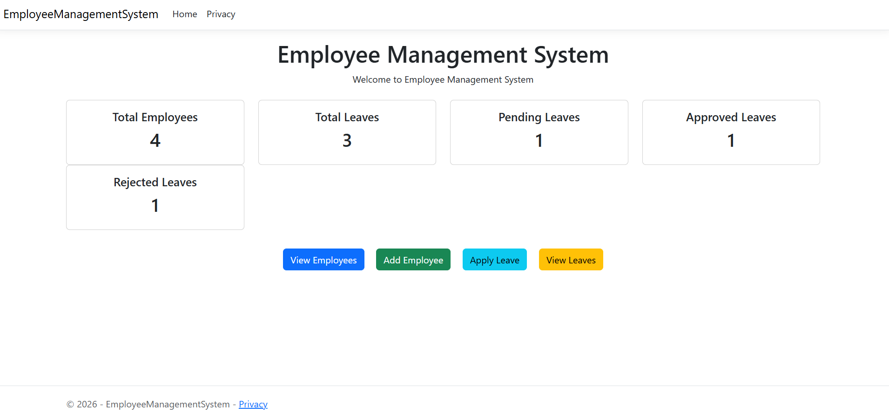
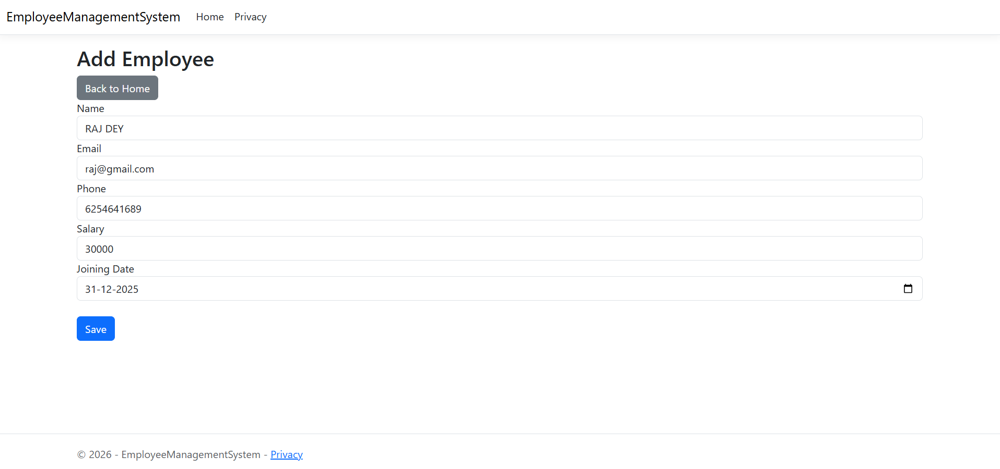
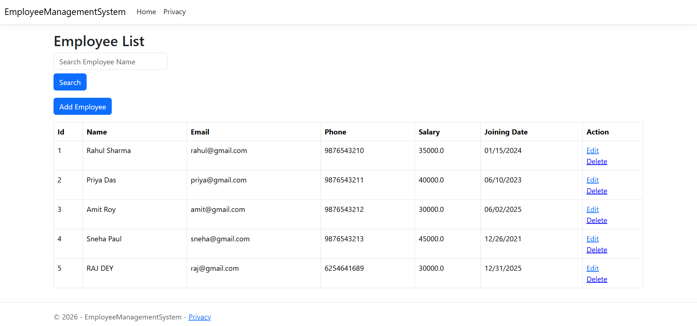
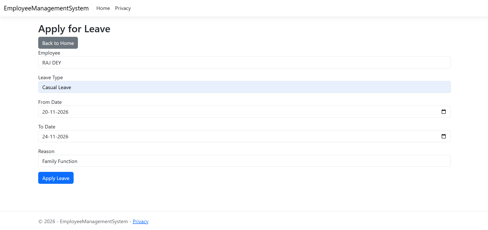
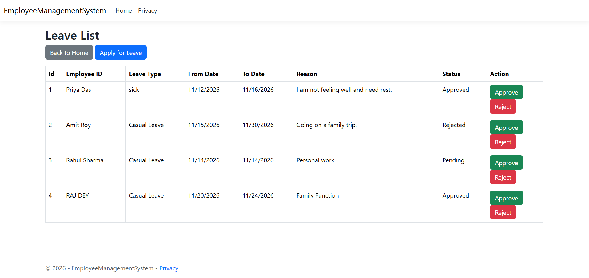
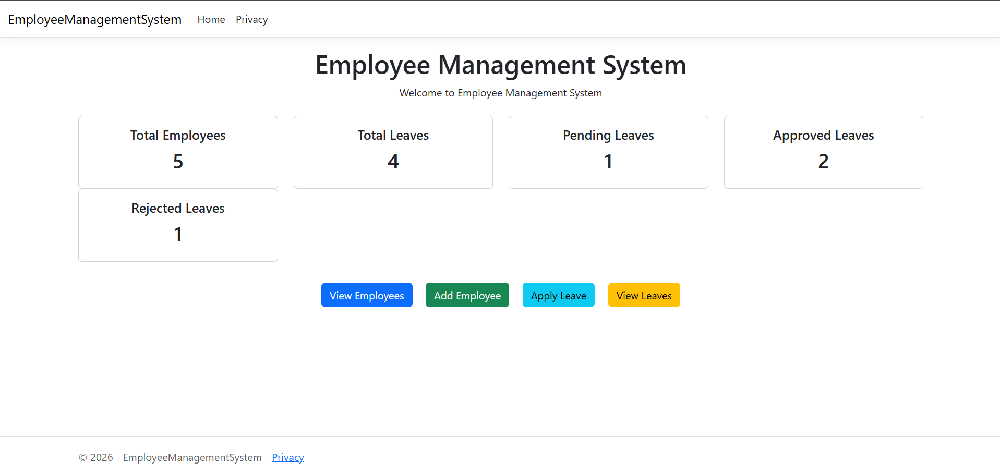

# Employee Management & Leave Tracking System

A web-based Employee Management and Leave Tracking System developed using **ASP.NET Core MVC** and **Entity Framework Core**.

This application helps manage employee information and handle employee leave requests through a simple dashboard.

## 🚀 Features

### 1. Dashboard
- View Total Employees.
- View Total Leave Requests.
- View Pending Leaves.
- View Approved Leaves.
- View Rejected Leaves.

### 2. Employee Management
- Add new employees.
- View all employees.
- Search employees by name.
- Edit employee details.
- Delete employee records.

### 3. Leave Management
- Apply for employee leave.
- Select leave type and date range.
- Enter the reason for leave.
- View all leave requests.
- Approve or reject leave requests.
- Track leave status (Pending, Approved, Rejected).

## 📸 Application Screenshots

### 1. Home Dashboard
Shows summary cards: Total Employees, Total Leaves, Pending, Approved and Rejected leaves, along with quick action buttons.



### 2. Add Employee
Form to add a new employee with name, email, phone, salary and joining date.



### 3. Employee List
Lists all employees with search by name, and Edit / Delete options.



### 4. Apply for Leave
Employee can apply for leave by selecting leave type, from/to date and reason.



### 5. Leave List (Pending Request)
Displays all leave requests with status and Approve / Reject actions. The new request shows as **Pending**.


### 6. Leave List (After Approval)
After clicking Approve, the status changes to **Approved**.



### 7. Updated Dashboard
Dashboard counts update automatically: 5 employees, 4 total leaves, 1 pending, 2 approved, 1 rejected.



## 🛠️ Technologies Used

- **Backend:** C#, ASP.NET Core MVC
- **ORM:** Entity Framework Core
- **Database:** SQLite
- **Frontend:** HTML, CSS, Bootstrap, Razor Views
- **Development Environment:** Visual Studio / GitHub Codespaces

## 📂 Project Structure

```text
EmployeeManagementSystem/
│
├── Controllers/
│   ├── HomeController.cs
│   ├── EmployeeController.cs
│   └── LeavesController.cs
│
├── Models/
│   ├── Employee.cs
│   └── Leave.cs
│
├── Data/
│   └── AppDbContext.cs
│
├── Views/
│   ├── Home/
│   ├── Employees/
│   ├── Leaves/
│   └── Shared/
│
├── Migrations/
├── wwwroot/
├── screenshots/
├── appsettings.json
├── Program.cs
└── EmployeeManagementSystem.csproj
```

## ⚙️ How to Run the Project

### Step 1: Clone the Repository

```bash
git clone https://github.com/Rupsa667/EmployeeManagementSystem.git
```

### Step 2: Open the Project Folder

```bash
cd EmployeeManagementSystem/EmployeeManagementSystem
```

### Step 3: Restore Dependencies

```bash
dotnet restore
```

### Step 4: Update the Database

```bash
dotnet ef database update
```

### Step 5: Run the Application

```bash
dotnet run
```

Open the forwarded application URL in your browser.

## 📊 Application Workflow

1. Open the Dashboard to view employee and leave statistics.
2. Add and manage employee records.
3. Submit leave requests for employees.
4. View submitted leave requests.
5. Approve or reject pending requests.
6. Track the current status of each leave request.

## 🎯 Project Objective

The main objective of this project is to simplify employee record management and leave request handling through a web-based application.

It also demonstrates the use of ASP.NET Core MVC, Entity Framework Core, database operations, and the MVC architecture in a practical project.

---

**Developed as a C# and ASP.NET Core MVC project.**
